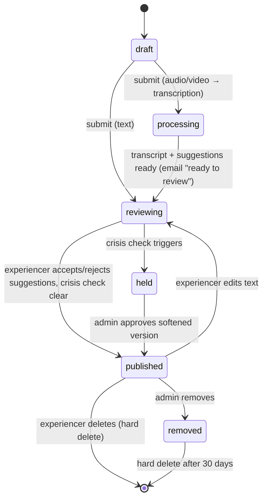

# ARCHITECTURE: Share Your Experience

**Status:** v0.3, **approved by Tom 2026-11-09**. Built (V1); setup steps in `docs/share/SETUP.md`.

> **As built (differences from the plan below):** uploads use `tus-js-client` directly (not Uppy) with an in-house recorder (`src/components/share/Recorder.tsx`); public pages read through a column whitelist in server code (`src/lib/share/public.ts`) instead of a database view; staging rows are marked `is_test` (no `test/` path prefix); Gemini is called through its REST API (`src/lib/ai/gemini.ts`), no SDK.
**PRD:** `PRD-SHARE-YOUR-EXPERIENCE.md` v0.3 (approved).
**Rule that shapes everything:** staging and production share one Supabase database. Every table, bucket, policy and cron below is a **production change that Tom runs**. Agents write the migration files and never apply them.

---

## 1. Overview

```mermaid
flowchart LR
    subgraph Browser
      R[/share wizard<br/>Uppy: record / upload] -->|TUS direct upload, user JWT| B[(Storage: story-media<br/>private)]
      R -->|server actions| A
    end
    subgraph "Next.js (App Hosting)"
      A[Server actions + route handlers<br/>src/app/share, src/app/api/share]
    end
    A --> DB[(Postgres: share_* tables)]
    A -->|signed URL| AAI[AssemblyAI<br/>transcription]
    AAI -->|webhook + secret| A
    A --> GEM[Gemini Pro<br/>edit suggestions, crisis softening, summary]
    A --> RS[Resend<br/>intros, invites, notices]
    subgraph "GitHub Actions (daily)"
      Y[share-youtube job:<br/>narrate anonymous + render + upload]
    end
    Y -->|/api/share/jobs/*, CRON secret| A
    Y --> YT[YouTube: PP channel]
    DB --> P[/experiences/slug<br/>/experiencer/slug]
```

**Principles**
- **Files never pass through Next.js.** Uploads go from the browser straight to Storage; there's a ~32 MB request cap on Cloud Run.
- **All writes go through server code that checks ownership.** The browser talks to Postgres directly only through RLS-protected reads of its own drafts.
- **Heavy work runs in GitHub Actions:** narration, video rendering, YouTube upload. This is the same pattern as PP's existing crons and Short Maker's voice and render jobs.
- **Contact details live in one admin-only table** and are never in a public view.

## 2. Data model (new tables, `public` schema, prefix `share_`)

| Table | Purpose | Key columns |
|---|---|---|
| `share_stories` | One row per story | `id uuid`, `user_id → auth.users`, `slug` (random, unique), `status` (see §3), `display_mode` (`named`/`anonymous`), `display_name`, `anon_number` (sequence), `experience_type`, `title`, `year_approx`, `country`, `region`, `language`, `appearance_pref` (`camera`/`audio_only`/`none`), `media_kind` (`text`/`audio`/`video`/`file`), `media_path`, `transcript`, `body_text` (published text), `summary` (2–3 sentences, for the directory), `narration_path`, `image_url`, `crisis_flag`, `intro_mode` (`none`/`all`/`selected`), `agreement_version`, `experiencer_profile_id` (named only), `is_test`, `published_at`, `youtube_status`, `youtube_video_id`, timestamps |
| `share_story_versions` | History of published text, so edits after publishing can be audited | `story_id`, `body_text`, `created_at` |
| `share_edit_suggestions` | Gemini suggestions, per section | `story_id`, `section_index`, `original`, `suggested`, `reason`, `kind` (`style`/`crisis`), `status` (`pending`/`accepted`/`rejected`), `model` |
| `share_intro_channels` | Channels an experiencer chose when `intro_mode = selected` | `story_id`, `channel_id → channels` |
| `share_contacts` | The **only** place for extra contact info | `user_id` PK, `phone`, `website`, `other`. RLS: owner only; admins through the service role |
| `share_agreements` | Who accepted which agreement version | `user_id`, `version`, `accepted_at`, `age_confirmed` |
| `share_channel_members` | Grants directory access | `user_id`, `channel_id`, `granted_by`, `granted_at`, `revoked_at` |
| `share_channel_invites` | Single-use invites | `id`, `email`, `channel_ids[]`, `token_hash`, `expires_at`, `used_at`, `revoked_at`, `created_by` |
| `share_intro_requests` | Introduction requests | `id`, `story_id`, `member_user_id`, `channel_id`, `note`, `status` (`pending`/`accepted`/`declined`/`expired`), `resend_message_id`, `opened_at`, `responded_at`, `response_token_hash` |

**Notes**
- **Email comes from `auth.users`.** It's never copied into the share tables.
- **No `channel_member` value in `profiles.role`.** Access is a row in `share_channel_members`, so the same person can be both an experiencer and a channel member, and revoking is one update.
- **Experiencer profiles.** `experiencer_profiles` is matched by **name** today (`src/lib/pipeline/experiencer-sync.ts:121`). Matching a submitter that way would attach their story to a stranger with the same name. Named submitters therefore get a **new** profile, linked through a new `experiencer_profiles.user_id` column. Merging with an existing video-based profile is a manual admin "link" action. *(Migration: Tom runs.)*
- **Deletion is a hard delete.** It removes the storage objects, then the rows: suggestions, versions, intros and the story itself. If a YouTube video exists, the job first writes a small tombstone `{youtube_video_id, delete_after}` to `share_youtube_removals`, so the daily job can delete the video.

## 3. Story lifecycle



- **The crisis check runs on the final text** after the suggestions are resolved, and again on every edit.
- **For audio and video, the experiencer comes back to review** after transcription. They can wait on the page (it polls) or follow the email link.

## 4. Key flows

### 4.1 Upload and recording
- **Uppy** in the `/share` wizard, with the Webcam and Audio plugins for in-browser recording and the Tus plugin for upload to `https://<project>.supabase.co/storage/v1/upload/resumable` using the user's JWT.
- **Re-takes stay in browser memory** until "Use this one". Only then does Uppy upload (PRD F8).
- **Recording format** is detected with `MediaRecorder.isTypeSupported()`, at an explicit ~2 Mbps bitrate. Long-video guidance is shown when browser video is selected (PRD F9).
- **Bucket `story-media`:** private, per-file limit **5 GB**, allowed MIME types for audio, video and documents. A 30-minute recording is about 450 MB from the browser (~2 Mbps), but 2–4 GB from a phone camera at 1080p (8–16 Mbps), so 2 GB would not cover phone uploads. **Tom must also raise the project-wide upload limit** in Supabase (Storage → Settings) to at least 5 GB.
- **Path:** `{user_id}/{story_id}/{random}.{ext}`. Storage RLS: insert, select and delete only where the first folder equals `auth.uid()`.
- **Text files** (`.txt .md .pdf .docx`, ≤10 MB) are parsed server-side with `unpdf` and `mammoth`. Only the extracted text is ever shown.

### 4.2 Transcription
- **On submit**, the server creates a 1-hour signed URL and calls AssemblyAI (US endpoint, since data is stored in the US anyway) with speaker labels and a webhook URL `/api/share/webhooks/assemblyai`, authenticated by a secret header.
- **The webhook** saves the transcript and triggers suggestions (§4.3).
- **Data retention:** AssemblyAI's is set to the minimum, and we delete the transcript on their side once it's received.

### 4.3 Editor suggestions (Gemini)
- **One call** to `gemini-pro-latest` (the same alias Short Maker uses, `short-maker/src/lib/env.ts`) with a strict JSON schema: `[{section_index, original, suggested, reason}]`.
- **The prompt allows light edits only:** paragraphs, typos, punctuation, a title, a 2–3 sentence summary. No new facts, and the person's voice is kept.
- **The UI** shows each section side by side with **Accept / Reject**, plus a free-text edit. `body_text` is assembled from the accepted results.
- **Crisis stories:** a second call produces `kind = crisis` suggestions (softened wording). Tom approves them in `/admin/share`.
- **New:** `GEMINI_API_KEY` in App Hosting secrets, a `src/lib/ai/gemini.ts` wrapper recorded through the existing `usage-tracker.ts`/`budget.ts`, and `'google'` added to its `Provider` type.

### 4.4 Publishing
- **The website reads published stories** at `/experiences/[slug]` (new route) and on `/experiencer/[slug]` for named ones. Pages revalidate on publish, edit and delete (`revalidatePath`).
- **Media on the website:**
  - before the YouTube upload: a short-lived signed URL generated at render time;
  - after: the YouTube embed.
  - Anonymous stories show the text, the AI image and the synthetic narration, never the original recording.
- **Public pages read through a security-definer view, `share_public_stories`.** It exposes only published, non-test rows and only public columns (no `user_id`, no `media_path` for anonymous stories).

### 4.4a Story library: Watch, Listen, Read
`/experiences` has three tabs. What each story appears in:

| Shared as | Watch | Listen | Read |
|---|---|---|---|
| Video | original video | the video's audio track | transcript (edited) |
| Audio | – | original audio | transcript (edited) |
| Text / file | – | synthetic narration, labelled (once generated) | text |

Whether the full name is shared doesn't change this (Tom, 2026-11-09: "don't share my full name" hides the name only). Originals are kept privately until the person deletes the story. Migration `20261109_004` drops the old "no video without the full name" constraint.

### 4.5 Daily YouTube batch (GitHub Actions)
`.github/workflows/share-youtube.yml` runs once a day, using the same pattern as Short Maker's `voice.yml`/`render.yml`.

**Steps:**
1. **Fetch the queue:** `GET /api/share/jobs/youtube-queue` with `CRON_SECRET` (`src/lib/auth/cron-auth.ts`) returns stories that are `published`, not `held`, not `is_test`, older than 12 hours, and not yet uploaded. Each comes with signed media URLs.
2. **Narration** for anonymous stories and text-only stories: **Chatterbox** (open source, MIT, free CPU runner), cloning **Tom's voice sample** (the one Short Maker uses; Tom's own voice, so PP has the rights). Never an experiencer's voice. Every narrated version is labelled "Read by a synthetic voice". Fallback: the existing ElevenLabs code (`src/lib/pipeline/experience-tts.ts`).
3. **Render with ffmpeg:** the image (`experience-image.ts`) plus narration plus burned-in captions from the text. Named video stories upload the original file.
4. **Upload** to the PP channel with a YouTube Data API refresh token from **PP's own Google Cloud project** (separate from Short Maker's; it needs YouTube's API audit before uploads can be public), reusing Short Maker's approach (`short-maker/src/lib/youtube/api.ts`, `meta.ts`).
5. **Report back:** `POST /api/share/jobs/youtube-result` saves `youtube_video_id`.
6. **Removals:** process `share_youtube_removals` with `videos.delete`.

**YouTube constraints (to verify before building):**
- **Uploads from an unaudited API project stay private.** Short Maker's notes already say so. Either reuse Short Maker's Google Cloud project once it passes the audit, or apply for the audit for PP.
- **Daily upload quota.** `videos.insert` costs a lot of quota units against a default of 10,000 per day, which allows only a handful of uploads per day. Check the current cost; ask for a quota increase if volume needs it.

### 4.6 Channel invites and directory
1. **`/admin/share/channels` → Send invite:** creates a 32-byte random token (only its hash is stored) that expires in 7 days, and emails `https://projectprofound.org/channels/join?token=…` from `invites@projectprofound.org`.
2. **`/channels/join`:**
   - If the visitor isn't signed in, show email-link sign-in, with the email pre-filled.
   - The server checks: token valid, unused, not revoked, and `auth email == invite email`. Then it inserts `share_channel_members` rows and marks the token used.
3. **`/channels/directory`** (members only):
   - Lists published stories with `intro_mode = all`, or `selected` and including one of the member's channels.
   - Shows only the directory fields from PRD F19. It's served from a server component, never a client-side Supabase query.
   - The first visit asks the member to accept the **channel code of conduct** (versioned, like the experiencer agreement).

### 4.7 Introductions
1. **The member clicks "Request an introduction"** and writes a note. The app creates a row, rate-limited to 10 per member per week (proposed).
2. **Resend emails the experiencer** from `intros@projectprofound.org`, with **Accept / Decline** links (single-use token) and open tracking turned on.
3. **On Accept:** one email to both people, with the experiencer's account email plus any `share_contacts` fields they ticked, and the member's email and channel. After that, PP is out of the loop.
4. **On Decline, or no reply after 14 days:** a polite email to the member, with no reason given.
5. **`opened_at`** is updated from Resend's open webhook.

## 5. Security

| Concern | Control |
|---|---|
| Contact info leaking | Contact details exist only in `auth.users` and `share_contacts` (owner and service role only). Public view, directory and admin lists never select them. **Test:** query every public and member endpoint as anon and as a member, and assert that no email or phone appears. |
| Drafts and media visible to others | RLS: owner-only select on non-published rows; Storage RLS by folder; signed URLs ≤1 h for media. |
| Invite and response tokens | 256-bit random, only the hash stored, single use, expiry, constant-time compare. |
| Webhooks | AssemblyAI and Resend secrets checked in headers. Job endpoints use `hasValidCronSecret`. |
| Abuse | Sign-in required; 5 submissions per account per day; intro rate limit; admin removal. |
| Staging writing real data into prod tables | See §6. |
| AI providers | AssemblyAI (US), Gemini (paid tier, not used for training), YouTube, Resend. All are named in the agreement. |

## 6. Staging on a shared database

- **`SHARE_ENV=staging`** is set only on the staging App Hosting backend. Every row staging writes gets `is_test = true`. Production pages, the directory, intro emails and the YouTube job **filter out `is_test`**.
- **Storage paths on staging** are prefixed `test/`. A weekly admin action deletes test rows and files older than 7 days.
- **Feature flag `SHARE_ENABLED`:** `/share` returns 404 in production until Tom turns it on.
- **Never use real experiencer stories on staging.**

## 7. Migrations (written by agents, run by Tom, in order)

1. `share_*` tables + enums + sequence + RLS policies.
2. `experiencer_profiles.user_id` column + index.
3. The `share_public_stories` view (security definer, minimal columns).
4. The `story-media` bucket + Storage RLS policies (SQL on `storage.buckets` / `storage.objects`).
5. Cleanup jobs: purge `removed` stories after 30 days, purge `is_test` after 7 days. These go in pg_cron (existing pattern) or the daily Action.

Each migration ships with a matching **down** script, and a verification query for Tom to run afterwards.

## 8. Reuse map

| Need | Reuse |
|---|---|
| Sign-in (Google + email link) | `src/app/login`, `src/app/auth/callback/route.ts` |
| Admin guard | `src/lib/auth/admin-guard.ts` |
| Cron/job auth | `src/lib/auth/cron-auth.ts` |
| Email | `src/lib/email/resend.ts` + new templates in `src/lib/email/templates/` |
| Crisis check | `src/lib/questions/crisis-detection.ts` (extend: international helplines) |
| AI image | `src/lib/pipeline/experience-image.ts` (fal) |
| TTS fallback | `src/lib/pipeline/experience-tts.ts` (ElevenLabs) |
| Cost tracking | `src/lib/ai/usage-tracker.ts`, `budget.ts` |
| Embeddings (published text only) | `src/lib/pipeline/insert-embedding-rows.ts` |
| YouTube upload, Chatterbox job | Short Maker: `src/lib/youtube/*`, `voice/tts.py`, `.github/workflows/voice.yml` (copy the pattern, don't share code) |

## 9. New dependencies and secrets

- **npm:** `@uppy/core`, `@uppy/dashboard`, `@uppy/webcam`, `@uppy/audio`, `@uppy/tus`, `unpdf`, `mammoth`, `@google/genai`, `assemblyai` (or plain fetch).
- **Secrets (App Hosting):** `GEMINI_API_KEY`, `ASSEMBLYAI_API_KEY`, `ASSEMBLYAI_WEBHOOK_SECRET`, `RESEND_WEBHOOK_SECRET`, `YOUTUBE_REFRESH_TOKEN` (or in GitHub Actions only), `SHARE_ENV`, `SHARE_ENABLED`.

## 10. Build order (each step: staging, Tom tests, then the next)

1. Migrations 1–4 (Tom runs) + the agreement page + `/share` text-only flow + `/experiences/[slug]` + delete.
2. Gemini editor suggestions + crisis hold + `/admin/share`.
3. Uppy upload and recording + AssemblyAI + the review-after-transcription step.
4. Anonymous display + named stories on `/experiencer/[slug]`.
5. Channel invites + directory + code of conduct.
6. Introductions + Resend webhooks.
7. The daily YouTube Action (narration, render, upload, removals).

## 11. Decisions (Tom, 2026-11-09)

1. **YouTube:** a separate Google Cloud project for PP.
2. **Narration voice:** Tom's own voice sample (the one Short Maker uses), via Chatterbox.
3. **Media limit:** 5 GB per file (2 GB doesn't cover a 30-minute phone video).
4. **Originals are kept** privately; the Watch / Listen / Read library is in §4.4a.
5. **Rate limits:** 5 stories per account per day; 10 intro requests per channel member per week.
